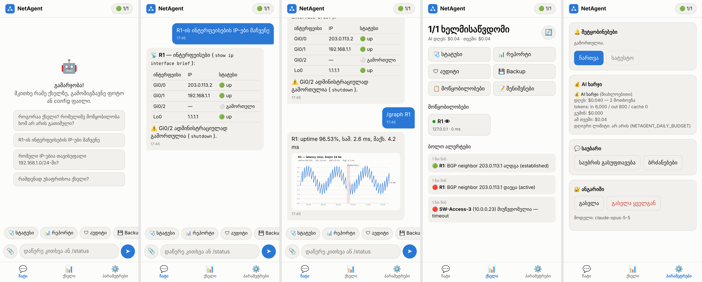
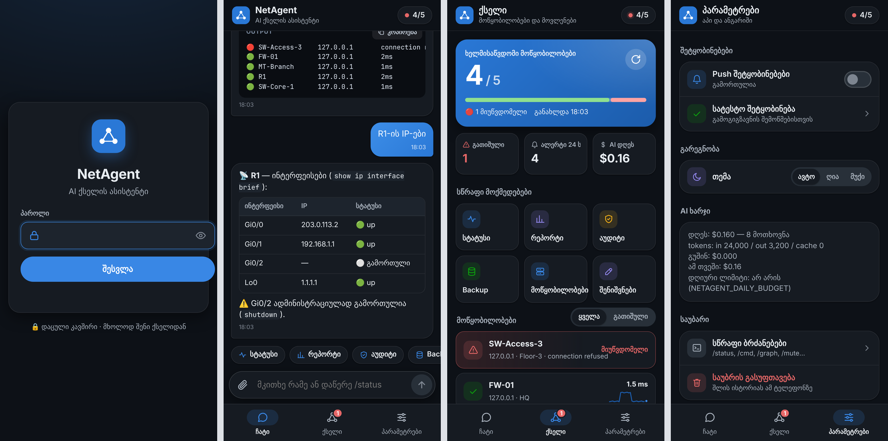
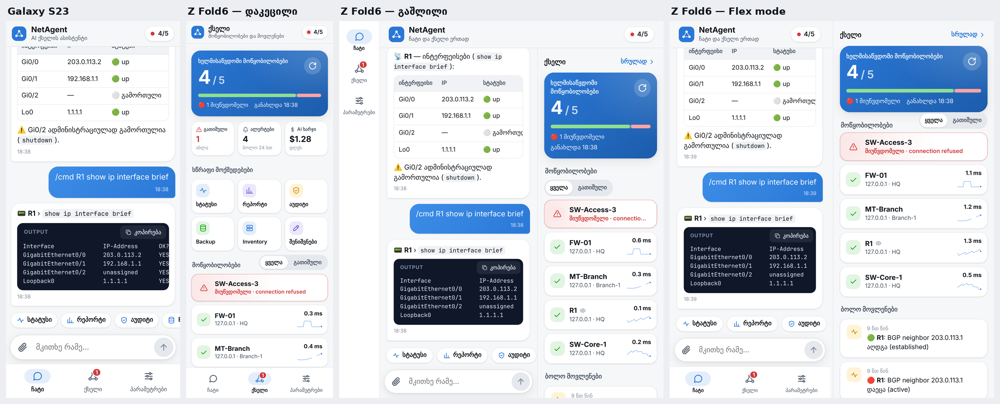

# NetAgent: AI ასისტენტი ქსელისთვის

Telegram-ში ან ტერმინალში ჩვეულებრივ ენაზე წერ, მაგალითად „R1-ის IP-ები მაჩვენე“. აგენტი თვითონ უკავშირდება მოწყობილობას, ასრულებს საჭირო `show` ბრძანებებს და შედეგს მოწესრიგებული სახით გიბრუნებს.

> **ნაგულისხმევად NetAgent მხოლოდ კითხულობს.** კონფიგურაციის ცვლილება მხოლოდ მაშინ არის შესაძლებელი, თუ თვითონ ჩართავ (`NETAGENT_CHANGES=on`). ამის შემდეგაც ყოველ ცვლილებას შენ ადასტურებ PIN-ით, ხოლო rollback ავტომატურად ხდება (იხ. [ცვლილებები](#-კონფიგურაციის-ცვლილებები-დადასტურებით)).

> 🎮 **მოწყობილობები ჯერ არ გაქვს?** გაუშვი `demo.bat` (ან `python -m netagent demo`): 4 ვირტუალური მოწყობილობა, ავარიის სცენარები და ყველა ფუნქცია, ნამდვილი ქსელის გარეშე. ნამდვილი MikroTik VirtualBox-ში: `lab-mikrotik.bat`. Cisco CML/GNS3: [docs/LABS.md](docs/LABS.md).

## რა შეუძლია

| კითხვის მაგალითი | რას აკეთებს აგენტი |
|---|---|
| `R1-ის ინტერფეისების IP-ები მაჩვენე` | `show ip interface brief` → TextFSM → ცხრილი |
| `192.168.1.57 სადაა ჩართული?` | ეძებს ყველა მოწყობილობის ARP/ინტერფეისებში (MAC-ის შემთხვევაში MAC ცხრილშიც) |
| `რომელ მოწყობილობაზეა 10.10.0.0/24?` | ქსელის ძებნა ყველა მოწყობილობაზე |
| `ყველა მოწყობილობის OS ვერსია` | პარალელურად ყველა მოწყობილობაზე |
| `BGP neighbor-ები R2-ზე` | შესაბამის `show` ბრძანებას თვითონ არჩევს |
| `SW-Core-1-ის კონფიგიდან ამოიღე VLAN-ები და IP-ები` | running-config-ის ანალიზი |
| 📄 config/log ფაილის ატვირთვა | IP, ქსელები, VLAN, MAC, ინტერფეისები და პრობლემები |
| `10.0.0.0/22 დაყავი /26-ებად` | subnet კალკულატორი |
| `example.com-ის MX ჩანაწერები` / `ღიაა 443 10.0.0.5-ზე?` | DNS, TCP port check, ping, traceroute |
| `რა შეიცვალა SW-Core-1-ის კონფიგში?` | იღებს backup-ს, ადარებს წინა ვერსიას და diff-ს ადამიანურ ენაზე ხსნის |
| `ყველა IP Excel-ში გამომიგზავნე` | ქმნის `.xlsx` ფაილს და აგზავნის Telegram-ში |
| `რომელი მოწყობილობაა გათიშული?` | ყველა მოწყობილობის ხელმისაწვდომობის შემოწმება |
| `რამდენად უსაფრთხოა ქსელი?` | უსაფრთხოების აუდიტი, პრობლემები სიმძიმით და გამოსწორების ბრძანებები |
| `რომელი IP-ებია თავისუფალი 10.1.1.0/24-ში?` | აგროვებს ყველა მოწყობილობის ARP/ინტერფეისის ცხრილებს |
| `ping R1-დან 8.8.8.8-მდე` | ping-ს თვითონ მოწყობილობიდან უშვებს |
| `როგორაა R1?` | ინტერფეისები, BGP, OSPF და CPU ერთი პასუხით |
| `R1-ის latency გრაფიკი` | გრაფიკს სურათად აგზავნის |
| `დაიმახსოვრე: R1-ის ISP არის Magti, circuit 12345` | ინახავს შენიშვნას და ინციდენტისას თვითონ გაიხსენებს |
| 📸 ფოტო: ეკრანი, შეცდომა, ტოპოლოგია | კითხულობს და ხსნის, რაც სურათზეა |
| `რატომ არ მუშაობს ინტერნეტი?` | Runbook: ping, DNS, default route, ping როუტერიდან და დასკვნა |
| `a4:5e:60:12:ab:01 რისი MAC-ია?` | მწარმოებლის ამოცნობა (IEEE OUI ბაზა) |
| `ახალი მოწყობილობა ხომ არ ჩართულა?` | ARP-ში ახლად გამოჩენილი MAC-ები და მათი მწარმოებლები |

### 📱 ტელეფონიდან სამუშაოდ
- **მენიუ ღილაკებით** (`/menu`): სტატუსი, მოწყობილობები, რეპორტი, backup, ყველა IP Excel-ში, OS ვერსიები, გათიშული პორტები, neighbors. ბრძანებების აკრეფა არ გჭირდება.
- **ბრძანებების სია:** შეტყობინების ველში `/`-ზე დაჭერისას ყველა ბრძანება ჩანს.
- **🚨 ალერტები:** ყოველ 5 წუთში მოწყობილობები მოწმდება და გათიშვის ან აღდგენის შემთხვევაში მაშინვე მიიღებ შეტყობინებას (გათიშვის ხანგრძლივობითაც).
- **📊 დილის რეპორტი:** ყოველდღე 09:00-ზე მოდის ჩართული/გათიშული მოწყობილობების სია და ბოლო 24 საათის config ცვლილებები. Backup ამავდროულად ავტომატურად კეთდება.
- **📎 ფაილები:** Excel ექსპორტი პირდაპირ ჩატში მოდის. config/log ფაილის ატვირთვის შემთხვევაში ბოტი მის ანალიზს გიბრუნებს.
- **📝 Config ცვლილების ალერტი:** ყოველ საათში მოწმდება, შეცვალა თუ არა ვინმემ კონფიგურაცია. ცვლილების შემთხვევაში მოდის ალერტი diff-ით.
- **🔕 დადუმება:** ალერტზე არის ღილაკი „🔕 1 სთ“, ასევე შეგიძლია გამოიყენო `/mute R1 2h` ან `/mute all 30m` (მაგ. სამუშაოების დროს). დადუმება სერვერის გადატვირთვის შემდეგაც რჩება.
- **🔘 ღილაკები პასუხის ქვეშ:** 🔄 განახლება (იგივე კითხვა ხელახლა) და 📊 Excel-ად.
- **💻 `/cmd`:** `/cmd R1 show ip route`, `/cmd all show clock`. show ბრძანებას პირდაპირ უშვებს, AI-ს გარეშე. დიდი output ფაილად მოდის.

`/status`, `/cmd`, `/audit`, `/backup`, `/report`, `/usage` და `/devices` AI-ს არ იყენებენ, ამიტომ სწრაფია და API-ს ხარჯი არ აქვს.

### 🔍 მოწყობილობების ავტომატური აღმოჩენა
`/discover 10.0.0.0/24` (ან `python -m netagent discover 10.0.0.0/24 --add`):
1. ქსელში ეძებს SSH-ით (პორტი 22) ხელმისაწვდომ მისამართებს
2. `default` credentials-ით შედის და ამოიცნობს, რა მოწყობილობაა (Cisco, Juniper, Arista, Huawei, HP, Fortinet, MikroTik...)
3. hostname-ს prompt-იდან იღებს
4. გაჩვენებს სიას ღილაკით **[➕ დამატება]** და დადასტურების შემდეგ მოწყობილობებს `devices.yaml`-ში ამატებს (კომენტარები ფაილში რჩება)

სხვა credentials პროფილის გამოსაყენებლად: `/discover 10.20.0.0/24 mikrotik`.

### 📈 სიღრმისეული მონიტორინგი (`watch`)
`devices.yaml`-ში მოწყობილობას დაამატე `watch` სექცია:
```yaml
  R1:
    host: 10.0.0.1
    device_type: cisco_ios
    watch:
      interfaces: [Gi0/0, Gi0/1]   # uplink-ები
      bgp: true
      ospf: true
      cpu: 80
```
ყოველ 5 წუთში შემოწმდება და მოვა ალერტი, მაგალითად:
- 🔴 R1 GigabitEthernet0/0 ჩავარდა / 🟢 აღდგა
- 🔴 R1: BGP neighbor 203.0.113.1 დაეცა (active)
- 🔴 R1: OSPF neighbor 2.2.2.2 დაეცა
- 🔥 R1: CPU 91% (ზღვარი 80%)

ინტერფეისები მოწმდება Cisco IOS/XE/NX-OS, Arista, Juniper, MikroTik, Huawei/HP და Linux-ზე. BGP/OSPF მოწმდება Cisco, Arista, Juniper და Huawei-ზე.

`/health R1` ყველაფერს ერთბაშად აჩვენებს, `watch`-ის გარეშეც.

### 📊 Latency გრაფიკი
მონიტორინგი ყველა მოწყობილობის პასუხის დროს ინახავს 14 დღის განმავლობაში. `/graph R1` (ან `/graph R1 48`) გამოგიგზავნის გრაფიკს uptime %-ით და საშუალო/p95/მაქსიმალური latency-ით. გათიშვის პერიოდები გრაფიკზე წითლადაა მონიშნული.

### 📝 შენიშვნები
- `/note R1 ISP: Magti, circuit 12345, ტელ: ...` ინახავს შენიშვნას მოწყობილობაზე
- `/note ოფისის ქსელი 192.168.0.0/16` ინახავს ზოგად შენიშვნას
- `/notes`, `/notes R1` აჩვენებს შენიშვნებს, `/delnote R1 2` შლის მათ
- ან უბრალოდ მისწერე აგენტს: „დაიმახსოვრე...“

აგენტი პრობლემის გარჩევისას შენიშვნებს თვითონ კითხულობს, ინციდენტის მოგვარების შემდეგ კი გთავაზობს მიზეზისა და გადაწყვეტის შენახვას.

### 📸 ფოტოები
Telegram-ში გაუგზავნე ფოტო ან screenshot (კონსოლის შეცდომა, ტოპოლოგიის ნახაზი, rack, ლეიბლი) და შეგიძლია კითხვაც დაურთო. აგენტი ტექსტს ამოიკითხავს, აგიხსნის და საჭიროების შემთხვევაში ცოცხალ მოწყობილობაზეც გადაამოწმებს. CLI-ში: `python -m netagent ask --image error.png "რა შეცდომაა?"`.

### 🗺 ქსელის რუკა (`/map`)
აგენტი ყველა მოწყობილობიდან კითხულობს CDP/LLDP neighbor-ებს და ხატავს რუკას: ვინ ვისთანაა მიერთებული და რომელი პორტებით. ლურჯი წრე inventory-ში არსებული მოწყობილობაა, ნაცრისფერი უცნობი neighbor (მაგ. AP ან ტელეფონი), წითელი კი მიუწვდომელი მოწყობილობა. AI-საც შეგიძლია ჰკითხო: „რა უერთდება SW1-ს?“

MikroTik-ზე საჭიროა `/ip neighbor discovery-settings` ჩართული, Cisco-ზე `cdp run` ან `lldp run`.

### 📜 Syslog (`/logs`)
NetAgent ლოგებს იღებს UDP 514 პორტზე. მოწყობილობებზე მიუთითე NetAgent-ის კომპიუტერის IP:

| პლატფორმა | ბრძანება |
|---|---|
| Cisco IOS | `logging host 192.168.1.10` |
| MikroTik | `/system logging action add name=netagent target=remote remote=192.168.1.10`<br>`/system logging add topics=info,!debug action=netagent` |
| Juniper | `set system syslog host 192.168.1.10 any notice` |

ალერტი ავტომატურად მოდის შემდეგ შემთხვევებში:
- 📝 config-ის შეცვლა (ვინ შეცვალა და საიდან)
- 🔴 ინტერფეისის ჩავარდნა
- 🔴 BGP/OSPF neighbor-ის დაცემა
- 🔐 5 ან მეტი წარუმატებელი შესვლა 10 წუთში
- 🔥 critical დონის შეტყობინებები

ერთნაირი ალერტი ერთ მოწყობილობაზე 10 წუთში ერთხელ მეტჯერ არ მოდის. `/logs R1` აჩვენებს ბოლო ლოგებს, ხოლო `/logs R1 UPDOWN` ძებნით ფილტრავს. AI-საც შეგიძლია ჰკითხო: „რატომ ჩავარდა Gi0/1?“, „ვინ შეცვალა R1-ის config?“. ლოგები 14 დღე ინახება.

> Windows-ში პირველ გაშვებაზე Firewall იკითხავს Python-ისთვის წვდომის დაშვებას. აირჩიე **Private networks → Allow**, სხვა შემთხვევაში ლოგები ვერ მოვა.

### 📚 Runbook-ები (`/runbook`)
პრობლემისას აგენტი შემოწმებების მზა ჯაჭვს გადის, როგორც გამოცდილი ინჟინერი, და ბოლოს **დასკვნას** წერს:

| ბრძანება | რას ამოწმებს |
|---|---|
| `/runbook internet` | ping და DNS ამ კომპიუტერიდან, ყველა მოწყობილობის ხელმისაწვდომობა, default route როუტერებზე, ping 8.8.8.8 როუტერიდან |
| `/runbook device R1` | SSH, ping, ინტერფეისები/BGP/OSPF/CPU, ბოლო 24 სთ-ის err ლოგები, config ცვლილებები, შენიშვნები |
| `/runbook slow` | latency p95 ბოლო 1 სთ-ში და CPU ყველა მოწყობილობაზე |

AI თვითონაც იყენებს მათ, როცა წერ „ინტერნეტი არ მუშაობს“ ან „R1 რაღაც ცუდადაა“.

### 🔎 MAC მწარმოებელი და 🆕 უცნობი მოწყობილობები
- `/mac a4:5e:60:12:ab:01` აჩვენებს მწარმოებელს. ბაზა (IEEE, ~50 000 ჩანაწერი) პირველ გაშვებაზე ავტომატურად ჩამოიტვირთება, განახლება: `/mac update`. ტელეფონების შემთხვევითი (privacy) MAC-ებიც ამოიცნობა.
- NetAgent ყოველ 15 წუთში კითხულობს ARP ცხრილებს. ქსელში **ახალი MAC** თუ გამოჩნდება, ალერტს მიიღებ IP-ით, მწარმოებლით და იმ მოწყობილობის სახელით, სადაც გამოჩნდა. პირველი სკანირება მხოლოდ საწყის სიას იმახსოვრებს. `/newdevices` აჩვენებს ბოლო 24 საათში ახლად გამოჩენილ MAC-ებს. ინტერვალი: `NETAGENT_NEW_DEVICE_INTERVAL` (`0` = გამორთული).

### 🏠 ლოკალური ქსელის სკანერი (`/scan`)
ქსელური მოწყობილობების გარეშეც მუშაობს: NetAgent-ის კომპიუტერიდან ასკანერებს შენს Wi-Fi/LAN-ს და აჩვენებს თითოეულ მოწყობილობას: IP, MAC, მწარმოებელი, სახელი, ღია პორტები და ტიპი (როუტერი, ტელეფონი, კამერა, პრინტერი, ტელევიზორი, NAS...). საშიშ ღია სერვისებზე (Telnet, RDP, SMB, VNC) გაფრთხილებას მიიღებ. `/scan 192.168.1.50` ერთი მოწყობილობის ~45 პორტს ამოწმებს. ყოველ 30 წუთში ავტომატურად ასკანერებს და **ახალ მოწყობილობაზე ალერტს** გიგზავნის (`NETAGENT_HOME_SCAN_INTERVAL`). მხოლოდ შიდა (private) ქსელებია დაშვებული.

### 📡 Live Devices (აპის ჩანართი „Live“, `/live`)
ვინ არის ლოკალურ ქსელში **ახლა**: IP, MAC, მწარმოებელი (offline OUI ბაზით), ქსელის სახელი (reverse DNS / NetBIOS / mDNS), ping რეალურ დროში, Online/Offline, პირველად/ბოლოს ნანახი. ახლის შემოსვლისას ხაზი ინიშნება, მოწყობილობაზე დაჭერით ჩანს ping-ის ცოცხალი გრაფიკი, ცხრილი სორტირდება და იძებნება, სია ექსპორტდება CSV-ში.
- ინტერფეისი და ქვექსელი ავტომატურად ირჩევა (შეგიძლია ხელითაც: VMware, Hyper-V და სხვ.); დიდი ქსელიდან მხოლოდ შენი /24 მოწმდება.
- Windows: ARP-ის მოთხოვნა (`ResolveIpNetEntry2`) + ICMP (`IcmpSendEcho`) — **ადმინის უფლება და Npcap არ სჭირდება**. Linux/macOS: ICMP socket ან `ping` + ARP ცხრილი, root-ის გარეშე (თუ რამე აკლია, პანელი წერს რა უნდა).
- Offline ხდება მხოლოდ რამდენიმე გამოტოვებული პასუხის **და** 20 წამის შემდეგ (ტელეფონის Wi-Fi ძილი არ ითვლება გასვლად); ping-ს თუ ბლოკავს, მაგრამ ARP-ს პასუხობს — „ARP ✓“.
- შემოსვლა/გასვლა იწერება `logs/live-devices.log`-ში. MAC მხოლოდ იმავე ქსელში ჩანს — სხვა ქვექსელისთვის „N/A“.
- `.env`: `NETAGENT_LIVE=off` — გამორთვა, `NETAGENT_LIVE_RETENTION_DAYS=7` — რამდენ ხანს ახსოვს გასული მოწყობილობები. ინტერვალი იცვლება პანელში.

### 🏷️ მოწყობილობის ტიპი, ისტორია, ნაცნობები (Live)
- **ტიპი** ავტომატურად: ტელეფონი, კომპიუტერი, ტელევიზორი, პრინტერი, კამერა, IoT, NAS, კონსოლი, ქსელური — ღია სერვისებით (ყოველ 6 სთ-ში), სახელით და მწარმოებლით; ცხრილში აიქონით.
- **ონლაინ ისტორია**: მოწყობილობის დეტალებში ზოლი 24 სთ / 7 დღე (5-წუთიანი სიზუსტით).
- **ნაცნობი / უცნობი**: პირველ გაშვებაზე რაც ქსელშია, ნაცნობად ინიშნება. **უცნობის** შემოსვლაზე მოდის push (ღილაკით „ჩემია“); **ღამის რეჟიმში** (მაგ. 00:00-07:00) — ნებისმიერის შემოსვლაზე. `/trust IP` · `/untrust IP` · `/trust all`.

### 🛡 IoT უსაფრთხოება (`/iot`)
კამერები, ჭკვიანი სახლი, TV box, პრინტერი, როუტერი: Telnet, პაროლის გარეშე ღია ვიდეო (RTSP), პაროლის გარეშე MQTT, Android ADB, XMEye/Dahua/Hikvision პორტები, ძველი firmware-ის ვებ-სერვერები. **პაროლებს არ ცდის** — თითო ერთი უვნებელი მოთხოვნა. შედეგი ჩანს Live-ის დეტალებშიც.

### 📈 სიჩქარის ისტორია და PDF პროვაიდერისთვის
`/speedhistory 30` — გრაფიკი და სტატისტიკა; `/isp pdf 30` — A4 ანგარიში (ხელმისაწვდომობა, გათიშვები, დაყოვნება, სიჩქარე ტარიფთან შედარებით, ყველაზე ცუდი გაზომვები). ტარიფი: `NETAGENT_ISP_PLAN_MBPS`. კომპიუტერის ძილი/გამორთვა გათიშვად **არ** ითვლება.

### 🩺 თვითაღდგენა (`/heal`)
ცნობილი პრობლემები როუტერებსა და switch-ებზე (err-disabled პორტი, golden config-ით აკრძალული ხაზი) → მზა გამოსწორება → `/approve <id> <PIN>`. ცვლილებების სისტემის დაცვა (backup, `reload in 10`, წვდომის შემოწმება) + შემდეგ შემოწმება: თუ პრობლემა არ მოგვარდა, ცვლილება **ავტომატურად ბრუნდება**. საჭიროა `NETAGENT_CHANGES=on` და PIN. ფონური შემოწმება: `NETAGENT_SELFHEAL_INTERVAL=15`.

### 🗺 ცოცხალი რუკა („ქსელი“ ჩანართი)
მოწყობილობები და კაბელები (CDP/LLDP): ფერი — ონლაინ/გათიშული, კაბელის ფერი/სისქე — დატვირთვა (`/traffic`-ის მონაცემით). როუტერი ზემოთ, ყოველი შემდეგი ნაბიჯი ერთი რიგით ქვემოთ. მოწყობილობაზე დაჭერით: ჯანმრთელობა, დიაგნოსტიკა, ტერმინალი.

### 🌐 ინტერნეტის მონიტორი (`/isp`, `/speedtest`)
- ყოველ წუთში ამოწმებს ინტერნეტს (latency, packet loss) და იწერს **ყველა გათიშვას**: როდის დაიწყო, როდის აღდგა და რამდენ ხანს გაგრძელდა.
- ყოველ 12 საათში სიჩქარის ტესტს უშვებს speed.cloudflare.com-ით (~33 MB, `NETAGENT_SPEEDTEST_INTERVAL`).
- `/isp 7` აჩვენებს გრაფიკს და შეჯამებას 7 დღისთვის.
- `/isp report 30` ადგენს **ანგარიშს პროვაიდერისთვის**: uptime %, გათიშვების სია და საშუალო სიჩქარე. თუ `NETAGENT_ISP_PLAN_MBPS=100` მითითებულია, ანგარიში ტარიფთან შედარებასაც აჩვენებს.

### 🌍 საიტები, SSL და დომენები (`/sites`)
`/site add https://example.com სახელი` (ან `tcp://10.0.0.5:3389 RDP`) ამოწმებს მისამართს ყოველ 5 წუთში. ალერტი მოდის, როცა საიტი არ მუშაობს, როცა **SSL სერტიფიკატს** 14 დღეზე ნაკლები დარჩა ან არასანდოა, და როცა **დომენს** 30 დღეზე ნაკლები დარჩა.

### 🛠 სამუშაოები, შეხსენებები, განრიგი
- `/maintenance R1 22:00 1h firmware` ნიშნავს, რომ ამ დროს R1-ის ალერტები ჩუმად იქნება, მაგრამ ჟურნალში მაინც ჩაიწერება. `/maintenance all now 30m` ყველაფერს ადუმებს.
- **ესკალაცია:** თუ მოწყობილობა 15 წუთზე მეტია გათიშულია, შეხსენება ყოველ 15 წუთში მოდის (`NETAGENT_ESCALATE_MINUTES`), სანამ ღილაკს **✅ ვიცი, ვმუშაობ** (`/ack R1`) არ დააჭერ.
- `/schedule mon 09:00 /report`, `/schedule daily 08:30 /isp` ან `/schedule weekdays 18:00 რა მოხდა დღეს ქსელში?` (AI კითხვა) ამატებს განრიგში. `/schedules` აჩვენებს სიას.

### 📨 Email, Discord, Slack
`.env`-ში მიუთითე `NETAGENT_SMTP_*` / `NETAGENT_EMAIL_TO`, `NETAGENT_DISCORD_WEBHOOK` ან `NETAGENT_SLACK_WEBHOOK` (იხ. `.env.example`). Gmail-ისთვის გამოიყენე **App password** (Google Account → Security → App passwords) და არა ჩვეულებრივი პაროლი. შემოწმება: `/notify test`.

### 🎙 ხმით კითხვა, 📘 სწავლა
- ჩატში 🎙 ღილაკით ქართულად ლაპარაკობ, ტექსტი ველში ჩაიწერება და გაგზავნამდე შეგიძლია შეასწორო (Chrome, Android/კომპიუტერი).
- `/teach on` რთავს **სასწავლო რეჟიმს**: AI ყოველ ბრძანებას და შედეგს გიხსნის და ბოლოს „რა ვისწავლეთ“-ს წერს.
- `/quiz` გაძლევს CCNA დონის კითხვებს ღილაკებით. `/quiz lab` დემოში რაღაცას აფუჭებს და შენ უნდა იპოვო მიზეზი (`/quiz hint`, `/quiz solve`).

### ⬆️ განახლება და backup
- `/update` ამოწმებს, არის თუ არა ახალი ვერსია GitHub-ზე. ღილაკი **⬆️ განახლება** ჩამოტვირთავს მას, საჭიროებისას ბიბლიოთეკებს დააყენებს და NetAgent-ს თვითონ გადატვირთავს. `.env`, inventory და data ხელუხლებელი რჩება.
- `/selfbackup` ქმნის zip-ს: შენიშვნები, ისტორია, პარამეტრები, inventory და config backup-ები. `.env` (API key-ები) zip-ში არ შედის.

### 📶 ტრაფიკი და ინტერფეისების შეცდომები (`/traffic`, `/errors`)
`watch`-იან მოწყობილობებზე NetAgent ყოველ 5 წუთში კითხულობს ინტერფეისების მრიცხველებს. ალერტი მოდის, როცა:
- **CRC და input/output შეცდომები** იზრდება (ცუდი კაბელი, SFP ან duplex);
- ინტერფეისი ხშირად ირთვება და ითიშება;
- ხაზის **დატვირთვა** ≥90%-ია (`watch: {utilization: 80}`);
- **მეხსიერება** ≥90%-ია.

`/traffic R1` აჩვენებს ყველა ინტერფეისის ამჟამინდელ ტრაფიკს. `/traffic R1 Gi0/0/0 24` ხატავს გრაფიკს ბოლო 24 საათისთვის. `/errors` ჩამოთვლის ყველა ინტერფეისს, სადაც შეცდომებია.

### 🧱 Firewall-ის ანალიზი (`/firewall`)
Cisco ACL-ებსა და MikroTik filter-ის წესებში პოულობს:
- წესებს, რომლებიც **არასდროს იმუშავებს**, რადგან ზემოთ სხვა წესი მათ ფარავს;
- ზედმეტ (დუბლირებულ) წესებს;
- წესებს, რომლებსაც არცერთი პაკეტი არ დამთხვევია (0 matches);
- MikroTik chain-ებს, რომლებსაც ბოლოს drop არ აქვთ.

`/firewall R1 test tcp 10.0.0.5 8.8.8.8 443` გეტყვის, დაშვებულია თუ არა ეს ტრაფიკი და რომელი წესით.

### 🧭 ტრაფიკის გზა (`/path`)
`/path 192.168.10.21 8.8.8.8` გაჩვენებს, რომელ მოწყობილობებზე და ინტერფეისებზე გადის ტრაფიკი და სად ჩერდება: route არ არის, loop-ია, ან ISP-ზე გადის. გზას თითოეული როუტერის forwarding ცხრილით ადგენს (Cisco CEF, MikroTik, Junos).

### 🛡 CVE (`/cve`)
თითოეული მოწყობილობის OS ვერსიისთვის (IOS/IOS-XE/NX-OS, RouterOS, Junos, EOS, FortiOS, PAN-OS) ეძებს ცნობილ სისუსტეებს NIST NVD-ში. აჩვენებს სიმძიმეს და მონიშნავს ☠️-ით იმას, რაც **აქტიურად გამოიყენება თავდასხმებში** (CISA KEV). შედეგები ერთი დღე ინახება. თუ ბევრი მოწყობილობა გაქვს, NVD-ზე უფასოდ აიღე `NVD_API_KEY`.

### 📐 Golden config (`/golden`)
ამოწმებს, აქვს თუ არა ყველა მოწყობილობას სავალდებულო პარამეტრები (NTP, syslog, banner...) და ხომ არ აქვს აკრძალული (telnet, `ip http server`, SNMP public). წესები: `inventory/golden.yaml` (მაგალითი: `golden.example.yaml`), ტიპის, როლის ან საიტის მიხედვით.

### 📝 Config-ის ისტორია git-ით (`/history`)
ყოველი შეცვლილი backup `backups/_history/` git საცავში იწერება (პაროლები უკვე დამალულია). `/history R1` აჩვენებს ცვლილებების სიას, `/history R1 2` კი ხაზ-ხაზ diff-ს. გამორთვა: `NETAGENT_BACKUP_GIT=off`.

### 📒 ინციდენტები (`/incidents`)
ყოველი გათიშვა ან პრობლემა ავტომატურად ინციდენტად იწერება: როდის დაიწყო, რა ლოგები ახლდა და როდის აღდგა. `/incident 12 note ISP-მ კაბელი შეცვალა` ინახავს, რა გამოასწორა. შემდეგ ჯერზე AI ამას გაიხსენებს: „ეს უკვე მოხდა 3 კვირის წინ, მაშინ...“.

### 🪪 პასპორტი, 📊 კვირის PDF, 📑 IPAM
- `/passport` აჩვენებს მოდელს, სერიულ ნომერს, OS-ს და uptime-ს. გარანტიისა და EoL-ის თარიღებს inventory-ში ჩაწერ (`lifecycle: {warranty_until: 2026-03-01, eol: 2027-01-31}`), ვადის მოახლოებისას გაფრთხილებას მიიღებ. `/passport excel` ქმნის Excel-ს.
- `/weekly` ადგენს PDF ანგარიშს: ხელმისაწვდომობა, ალერტები, ინციდენტები და აღდგენის საშუალო დრო, ინტერნეტი, config ცვლილებები. ავტომატურად: `/schedule mon 09:00 /weekly`.
- `/ip 192.168.1.50 პრინტერი 2 სართული` არქმევს სახელს მისამართს. `/ipam add 192.168.1.0/24 ოფისი vlan 10` ამატებს ქსელს. `/ipam 192.168.1.0/24` აჩვენებს დაკავებულ და თავისუფალ მისამართებს. `/ipam excel` ქმნის Excel-ს.

### 📚 დამატებითი runbook-ები
`/runbook vpn` (IPsec/WireGuard), `/runbook wifi` (სიგნალი, არხი, დანაკარგი როუტერამდე, ამ კომპიუტერიდან), `/runbook dhcp` (IP არ ეძლევა, pool გავსებულია, IP კონფლიქტები).

### 🛠 კონფიგურაციის ცვლილებები (დადასტურებით)
ნაგულისხმევად გამორთულია. ჩასართავად:
1. `.env`-ში ჩაწერე `NETAGENT_CHANGES=on`.
2. გაუშვი `python -m netagent change-pin`, რომ PIN დააყენო (6–12 ციფრი).

როგორ მუშაობს:
- **შეთავაზება:** სთხოვე AI-ს, მაგ. „Gi0/5-ს description დაუწერე Printer და ჩართე“, ან დაწერე `/change R1 interface Gi0/5 ; description Printer ; no shutdown`. NetAgent გაჩვენებს ზუსტ ბრძანებებს და რისკებს. ამ ეტაპზე მოწყობილობას არაფერი ეგზავნება.
- **დადასტურება:** დააჭირე ✅-ს და შეიყვანე PIN. 5 არასწორი PIN-ის შემდეგ დადასტურება 15 წუთით იბლოკება. PIN ჩატში არ ჩანს: აპში დაფარულია, Telegram-ში კი შეტყობინება იშლება.
- **უსაფრთხოდ გატარება:**
  - **Cisco IOS/XE:** ჯერ იწერება rollback ასლი `flash:`-ზე და ირთვება `reload in 10` ტაიმერი. ბრძანებების გატარების შემდეგ NetAgent თავიდან უკავშირდება მოწყობილობას. თუ კავშირი არის, ტაიმერი უქმდება. თუ მოწყობილობამ ბრძანება არ მიიღო, ძველი კონფიგურაცია `configure replace`-ით ბრუნდება. თუ წვდომა დაიკარგა, მოწყობილობა 10 წუთში თვითონ დაბრუნდება ძველ (შენახულ) კონფიგურაციაზე.
  - **Junos:** `commit confirmed 5`, შემდეგ კავშირის შემოწმება და `commit`.
  - **MikroTik:** `/export` ასლი, შემდეგ გატარება და კავშირის შემოწმება. RouterOS-ზე ავტომატური დაბრუნება არ ხდება.
- **შემდეგ:** 💾 **შენახვა** (`write memory`) ან ↩️ **დაბრუნება** (`/undo 7`, PIN-ით).
- ყოველი ცვლილება იწერება audit-ში და backup-ის ისტორიაში (`/history`). `/changes` აჩვენებს ყველა ცვლილების სიას.
- აკრძალულია: `reload`, `erase`, `write`, `username`, `enable secret`, `aaa`, `boot`, `/system reset`, `/user` და სხვა სახიფათო ბრძანებები.

### 📊 ვინ ტვირთავს ინტერნეტს (NetFlow, `/top`)
როუტერებმა flow-ები ამ კომპიუტერს უნდა გამოუგზავნონ, UDP 2055-ზე (NetFlow v5/v9, IPFIX):

| პლატფორმა | ბრძანებები |
|---|---|
| MikroTik | `/ip traffic-flow set enabled=yes interfaces=all`<br>`/ip traffic-flow target add dst-address=192.168.1.10 port=2055 version=9` |
| Cisco IOS-XE | `flow exporter NA` → `destination 192.168.1.10` → `transport udp 2055`<br>`flow monitor NA` → `exporter NA` → `record netflow ipv4 original-input`<br>`interface Gi0/0/0` → `ip flow monitor NA input` |

`/top` ან „ვინ ტვირთავს ინტერნეტს?“ აჩვენებს ყველაზე აქტიურ შიდა მოწყობილობებს (⬇/⬆, სახელებით IPAM-დან და /scan-იდან), მიმართულებებს (YouTube, Netflix, Microsoft...) და აპლიკაციებს. დემოში flow-ები ავტომატურად მოდის.

### 📟 SNMP: პრინტერები, UPS, კამერები
მოწყობილობებისთვის, რომლებსაც SSH არ აქვთ: `device_type: snmp`, community კი `.env`-ში (`credentials: snmp: {community_env: SNMP_COMMUNITY}`). `/snmp Printer-2F` აჩვენებს სისტემას, ინტერფეისებს, **ტონერის დონეს** და **UPS-ის ბატარეას**. ალერტი მოდის, როცა ტონერი 10%-ზე ნაკლებია, როცა UPS ბატარეაზე გადავა (ანუ დენი გაითიშა) და როცა ბატარეა დაბალია. ხელმისაწვდომობის მონიტორინგიც ასეთ მოწყობილობებზე SNMP-ით მუშაობს.

### 📈 Grafana (Prometheus)
`.env`-ში მიუთითე `NETAGENT_METRICS_TOKEN=<გრძელი შემთხვევითი ტექსტი>`. ამის შემდეგ `http://127.0.0.1:8080/metrics` (Bearer token-ით) აბრუნებს შემდეგ მეტრიკებს: მოწყობილობების up/latency, ინტერნეტი, ინტერფეისების ტრაფიკი, შეცდომები და დატვირთვა, ალერტები, ღია ინციდენტები, AI ხარჯი, NetFlow ჰოსტები. Prometheus-ის კონფიგი `netagent/features/metrics.py`-შია.

### 📥 NetBox / Zabbix
`.env`-ში `NETBOX_URL` + `NETBOX_TOKEN`, ან `ZABBIX_URL` + `ZABBIX_TOKEN` (read-only token საკმარისია). `/import netbox` ან `/import zabbix` აჩვენებს სიას და ➕ ღილაკით ამატებს inventory-ში. Zabbix-ში ტიპს inventory-ის „OS“ ველიდან იღებს, ან tag-იდან `netagent_type`.

### 💻 ტერმინალი და 📱 მალსახმობები
- აპში არის **ტერმინალის** ჩანართი: ირჩევ მოწყობილობას, წერ ბრძანებას (ან აჭერ მზა ღილაკს) და შედეგს ხედავ. ↑ აბრუნებს წინა ბრძანებებს. მუშაობს მხოლოდ წაკითხვის რეჟიმში.
- **ინტერნეტის ბარათი** dashboard-ზე აჩვენებს uptime-ს, latency-ის გრაფიკს 24 საათისთვის, გათიშვებს და ბოლო სიჩქარეს.
- ტელეფონზე აპის ხატულაზე ხანგრძლივი დაჭერით გამოჩნდება მალსახმობები: **ქსელი**, **ტერმინალი**, **ჩატი**.

### 🛡 უსაფრთხოების აუდიტი (`/audit`)
config-ები მოწმდება ცნობილ პრობლემებზე. თითოეულ პრობლემას აქვს სიმძიმე (🔴/🟠/🟡) და გამოსწორების ბრძანება:

| პლატფორმა | რას ამოწმებს |
|---|---|
| Cisco IOS/XE | telnet VTY-ზე, `enable password`, სუსტი username პაროლი, SNMP `public`/`private`/RW, HTTP სერვერი, SSH v2, VTY ACL, NTP, AAA, password-encryption, syslog, `exec-timeout 0`, banner |
| Cisco NX-OS | telnet, SNMP, NTP, syslog |
| Juniper | telnet, FTP, HTTP, SNMP, root SSH, NTP, syslog |
| MikroTik | telnet/ftp/www/api სერვისები, MAC-server, SNMP public, ღია DNS, NTP, syslog |

ამის გარდა ყველა მოწყობილობაზე მოწმდება **დუბლირებული IP მისამართები**.

### 💰 AI ხარჯის კონტროლი
- `/usage` აჩვენებს დღევანდელ, გუშინდელ და თვიურ ხარჯს (მიახლოებით).
- `NETAGENT_DAILY_BUDGET=2` ნიშნავს, რომ დღეში $2-ის დახარჯვის შემდეგ AI ჩერდება მეორე დღემდე. AI-ს გარეშე ბრძანებები ამ დროსაც მუშაობს.

**მწარმოებლები:** Netmiko-ს მიერ მხარდაჭერილი ნებისმიერი მოწყობილობა (80+ პლატფორმა). მზა ბრძანებების რუკა უკვე აქვს ამ პლატფორმებს: Cisco IOS/XE/NX-OS/XR/ASA, Arista, Juniper, MikroTik, Huawei, HP Comware/ProCurve, Aruba CX, Fortinet, Palo Alto, Dell OS10, Extreme, VyOS/EdgeRouter, Linux. დანარჩენ მოწყობილობებზე აგენტი `run_show_command`-ს იყენებს და ბრძანებას მოწყობილობის საკუთარი სინტაქსით წერს.

## 📱 Android აპი (Telegram-ის გარეშე)

NetAgent-ს აქვს საკუთარი აპი ტელეფონისთვის და კომპიუტერისთვის. აპში არის:
- 💬 **ჩატი:** ჩანს, რას აკეთებს აგენტი („📡 R1: ip_addresses...“). შეგიძლია ატვირთო ფოტო ან ფაილი, ხოლო ტელეფონის დიდ ფოტოებს აპი თვითონ ამცირებს.
- 📊 **ქსელი:** ყველა მოწყობილობის სტატუსი, ბოლო ალერტები და სწრაფი ღილაკები. მოწყობილობაზე დაჭერით გამოჩნდება `/health`.
- 🔔 **Push შეტყობინებები:** ალერტები მოდის მაშინაც, როცა აპი დახურულია.
- ⚙️ **პარამეტრები:** შეტყობინებები, AI ხარჯი, საუბრის გასუფთავება, გასვლა.
- ჩატში ყველა სწრაფი ბრძანება მუშაობს: `/status`, `/cmd R1 show clock`, `/graph R1`, `/mute R1 2h`...



<details><summary>მუქი თემა</summary>


</details>

**დიზაინი:** Android-ის სტილის ინტერფეისი SVG ხატულებით. ღია, მუქი და ავტომატური თემა (⚙️ → თემა). Dashboard-ზე ჩანს ყველა მოწყობილობის latency-ის მინი-გრაფიკი (sparkline), ხოლო CLI output ტერმინალის სტილის ბლოკშია, „კოპირება“ ღილაკით.

### 📱 Samsung Galaxy S23 და Z Fold6


| ეკრანი | განლაგება |
|---|---|
| **Galaxy S23** (~360px) და **Fold6 დაკეცილი** (~344px) | ერთი პანელი, ქვედა მენიუ. ზომები ვიწრო ეკრანზეა მორგებული: არაფერი იჭრება და გვერდზე არ გადის |
| **Fold6 გაშლილი** (~707×823), ვერტიკალურად ან ჰორიზონტალურად | **ჩატი და ქსელი ერთად**, ორ პანელად, მარცხნივ კი გვერდითი მენიუ. მოწყობილობაზე დაჭერით მისი მდგომარეობა ჩატში გამოჩნდება, ხოლო „სრულად ›“ ქსელის გვერდს მთელ ეკრანზე გახსნის |
| **Fold6 Flex mode, წიგნივით** | პანელები **ზუსტად ნაკეცთან** იყოფა: მარცხნივ ჩატია, მარჯვნივ ქსელი |
| **Fold6 Flex mode, ლეპტოპივით** | ზემოთ საუბარია, **ქვემოთ შეყვანის ველი** და სწრაფი ღილაკები |

Fold-ის გაშლა/დაკეცვისას ან მობრუნებისას აპი განლაგებას ავტომატურად ცვლის. ჩატის ისტორია ამ დროს რჩება.

> 💡 Samsung-ზე **Chrome** გამოიყენე. Samsung Internet-იც მუშაობს (მენიუ → „Add page to“ → „Home screen“), მაგრამ ნამდვილ აპად (WebAPK) ინსტალაციას და შეტყობინებებს Chrome ყველაზე საიმედოდ ასრულებს.

აპი Google Play-ს გარეშე, მხოლოდ შენთვის ინსტალირდება. Android-ზე Chrome მას ნამდვილ აპად აყენებს (WebAPK): ხატულით, სრულ ეკრანზე და შეტყობინებებით.

### როგორ მუშაობს
```
📱 ტელეფონი (NetAgent აპი)  ──Tailscale (დაშიფრული, კერძო)──▶  🖥 სერვერი ოფისში ──SSH──▶ 🔀 მოწყობილობები
```
აგენტი სერვერზე მუშაობს, ტელეფონში კი მხოლოდ აპია. Tailscale უფასოა და ტელეფონს სერვერთან ისე აკავშირებს, რომ router-ზე პორტის გახსნა არ გჭირდება და ინტერნეტში არაფერი იხსნება.

### დაყენება (ერთხელ)

**1. სერვერზე: აპის პაროლი და 2FA**
```bash
python -m netagent web-setup --totp
```
პაროლი შეიყვანე, ხოლო გამოჩენილი 2FA გასაღები ჩაწერე Google Authenticator-ში (➕ → „Enter a setup key“).

**2. სერვერზე: გაშვება**
```bash
python -m netagent serve
```
ერთი პროცესი უშვებს აპს, მონიტორინგს და (ტოკენის არსებობის შემთხვევაში) Telegram-საც. Telegram-ის გამოსართავად `.env`-ში ჩაწერე `NETAGENT_TELEGRAM=off`.

**3. Tailscale: სერვერზე და ტელეფონზე**
1. დარეგისტრირდი [tailscale.com](https://tailscale.com)-ზე (უფასოა პირადი გამოყენებისთვის).
2. დააყენე Tailscale სერვერზე ([tailscale.com/download](https://tailscale.com/download)) და შედი იმავე ანგარიშით.
3. Tailscale admin console → **DNS** → ჩართე **MagicDNS** და **HTTPS Certificates**.
4. სერვერზე გაუშვი:
   ```bash
   tailscale serve --bg 8080
   ```
   ბრძანება დაბეჭდავს მისამართს, დაახლოებით ასეთს: `https://office-server.tail1234.ts.net`
5. ტელეფონზე Google Play-დან დააყენე **Tailscale** აპი და შედი იმავე ანგარიშით.

**4. ტელეფონზე: აპის დაყენება**
1. Chrome-ში გახსენი მე-3 ნაბიჯის მისამართი (`https://...ts.net`).
2. შედი პაროლით და 2FA კოდით.
3. Chrome-ის მენიუ (⋮) → **„Install app“** / **„Add to Home screen“**.
4. მთავარ ეკრანზე გაჩნდება **NetAgent**-ის ხატულა.
5. აპში გახსენი ⚙️ → **🔔 შეტყობინებები → ჩართვა** → **სატესტო**.

> 💡 Tailscale ტელეფონზე ჩართული უნდა იყოს. შეგიძლია Android-ის პარამეტრებში მისთვის „Always-on VPN“ ჩართო.
> კომპიუტერზეც იგივე მისამართი გახსენი Chrome-ში ან Edge-ში და გამოიყენე „Install app“.

### უსაფრთხოება
- **წვდომა:** მხოლოდ შენს Tailscale ქსელში, ინტერნეტიდან სერვერზე არაფერი ჩანს. სერვერი მხოლოდ `127.0.0.1`-ზე უსმენს.
- **შესვლა:** პაროლი (scrypt hash) და 2FA. 5 წარუმატებელი ცდის შემდეგ შესვლა 15 წუთით იბლოკება.
- **Cookie:** HttpOnly და SameSite=Strict, ასევე CSRF და CSP დაცვა. „გასვლა ყველგან“ ყველა სესიას აუქმებს.
- **ისტორია:** ჩატის ისტორია მხოლოდ შენს ტელეფონზე ინახება. ⚙️ → „საუბრის გასუფთავება“ მას შლის.

## ინსტალაცია

საჭიროა Python 3.10 ან უფრო ახალი.

### 🪟 Windows (უმარტივესი გზა)
1. დააყენე **Python 3.12** [python.org/downloads](https://www.python.org/downloads/)-დან. ინსტალაციისას აუცილებლად მონიშნე **„Add python.exe to PATH“**.
2. გადმოწერე კოდი და გახსენი `network-agent` საქაღალდე.
3. ორჯერ დააჭირე **`install.bat`**-ს. ის ყველაფერს დააყენებს და `.env`-საც შექმნის.
4. `notepad .env`: ჩაწერე `ANTHROPIC_API_KEY` და მოწყობილობების username/პაროლი.
5. `notepad inventory\devices.yaml`: ჩაწერე შენი მოწყობილობები, ან მოგვიანებით ჩატში გამოიყენე `/discover`.
6. **`setup-password.bat`**: აპის პაროლი და 2FA.
7. **`doctor.bat`**: ამოწმებს ყველაფერს და გეუბნება, რა აკლია.
8. **`start.bat`**: უშვებს NetAgent-ს. კომპიუტერზე გახსენი http://127.0.0.1:8080
9. **`autostart-on.bat`**: NetAgent Windows-ში შესვლისას ავტომატურად, ფონურ რეჟიმში ჩაირთვება (ფანჯრის გარეშე, გათიშვის შემთხვევაში თავიდან ირთვება). ლოგები: `logs\netagent.log`. გამორთვა: **`autostart-off.bat`**.

10. 🎮 **`demo.bat`**: სადემონსტრაციო ქსელი რეალური მოწყობილობების გარეშე (http://127.0.0.1:8090, პაროლი `netagent-demo`). ნამდვილ პარამეტრებს არ ეხება. ნამდვილი MikroTik VirtualBox-ში: **`lab-mikrotik.bat`**, დეტალები [docs/LABS.md](docs/LABS.md)-ში.

11. 🎁 **`share.bat`**: ქმნის `NetAgent-share-....zip`-ს Desktop-ზე, რომელიც სხვას შეგიძლია მისცე. შიგნით მხოლოდ კოდი და სკრიპტებია. `.env`, პაროლები, `devices.yaml` და `data` შიგ არ მოხვდება. ის, ვისაც მისცემ, ამოაარქივებს და იგივე ნაბიჯებს გაივლის (`install.bat` → თავისი API key `.env`-ში → `setup-password.bat` → `start.bat`). ასე თავის ქსელს და თავის მონაცემებს დაინახავს.

> ⚠️ სანამ NetAgent მუშაობს, კომპიუტერი არ უნდა დაიძინოს: Settings → System → Power → Sleep → **Never** (როცა დენზეა შეერთებული).

### Linux / Mac

```bash
cd network-agent
python3 -m venv .venv && source .venv/bin/activate
pip install -r requirements.txt

cp .env.example .env
cp inventory/devices.example.yaml inventory/devices.yaml
```

### 1. Anthropic API key
[console.anthropic.com](https://console.anthropic.com) → API Keys. ჩაწერე `.env`-ში: `ANTHROPIC_API_KEY=...`

### 2. Telegram ბოტი
1. Telegram-ში გახსენი **@BotFather** → `/newbot` → მიჰყევი ინსტრუქციას და მიიღე ტოკენი.
2. `.env`-ში ჩაწერე `TELEGRAM_BOT_TOKEN=...`
3. გაუშვი ბოტი (`python -m netagent.telegram_bot`) და მიწერე მას `/id`.
4. მიღებული ID ჩაწერე `.env`-ში `TELEGRAM_ALLOWED_USERS=123456789` სახით (რამდენიმე ID მძიმით გამოყავი) და ბოტი გადატვირთე.

### 3. მოწყობილობები
შეავსე `inventory/devices.yaml`:

```yaml
credentials:
  default:
    username_env: NET_USER      # .env-ის ცვლადის სახელი და არა პაროლი!
    password_env: NET_PASS
devices:
  R1:
    host: 10.0.0.1
    device_type: cisco_ios      # Netmiko platform
    site: HQ
    role: router
```

პაროლები ინახება მხოლოდ `.env`-ში. `inventory/devices.yaml` და `.env` `.gitignore`-შია, ამიტომ git-ში არ მოხვდება.

> 💡 რეკომენდაცია: აგენტისთვის მოწყობილობებზე შექმენი ცალკე მომხმარებელი, რომელსაც **მხოლოდ წაკითხვის უფლება** აქვს (Cisco: `privilege 1` ან `parser view`, MikroTik: `read` group, Juniper: `read-only` class). ასე დაცვის მეორე ფენა გექნება.

## გაშვება

```bash
# აპი + მონიტორინგი + Telegram (რეკომენდებული)
python -m netagent serve

# მხოლოდ Telegram ბოტი (აპის გარეშე)
python -m netagent.telegram_bot

# ტერმინალი: ინტერაქტიული ჩატი
python -m netagent

# ერთი კითხვა
python -m netagent ask "R1-ის ინტერფეისები"

# ფაილის ან ბრძანების output-ის გადაცემა pipe-ით
cat running.cfg | python -m netagent ask "ამოიღე VLAN-ები და IP-ები"

# AI-ს გარეშე, ლოკალურად: IP/VLAN/MAC-ის ამოღება ფაილიდან
python -m netagent extract running.cfg
python -m netagent extract running.cfg --json

# inventory-ს სია
python -m netagent devices

# რომელი მოწყობილობაა ჩართული/გათიშული
python -m netagent status

# config-ების backup (ყველა, ან ფილტრით, მაგ. HQ)
python -m netagent backup
python -m netagent backup HQ

# რა შეიცვალა R1-ზე ბოლო 24 საათში
python -m netagent diff R1 --hours 24

# რეპორტი
python -m netagent report

# უსაფრთხოების აუდიტი (--fix აჩვენებს გამოსწორების ბრძანებებს)
python -m netagent audit --fix

# დაკავებული / თავისუფალი IP-ები
python -m netagent ips 192.168.10.0/24

# ერთი show ბრძანება AI-ს გარეშე (pipe-ის შემთხვევაში ბრძანება ბრჭყალებში ჩასვი)
python -m netagent cmd R1 show ip route
python -m netagent cmd all "show running-config | include hostname"

# AI ხარჯი
python -m netagent usage

# ქსელის სკანირება და ახალი მოწყობილობების დამატება
python -m netagent discover 10.0.0.0/24 --add

# მოწყობილობის მდგომარეობა / latency გრაფიკი
python -m netagent health R1
python -m netagent graph R1 --hours 48

# შენიშვნები
python -m netagent note R1 "ISP: Magti, circuit 12345"
python -m netagent notes R1
python -m netagent note R1 --delete 1

# ფოტო კითხვასთან ერთად
python -m netagent ask --image error.png "რა შეცდომაა?"
```

Telegram-ის ბრძანებები: `/menu`, `/status`, `/map`, `/logs`, `/health`, `/graph`, `/discover`, `/note`, `/notes`, `/delnote`, `/cmd`, `/audit`, `/report`, `/backup`, `/mute`, `/unmute`, `/usage`, `/devices`, `/reset` (საუბრის თავიდან დაწყება), `/id`, `/help`.

### Backup-ები
Config-ები ინახება `backups/<მოწყობილობა>/<თარიღი>.cfg` ფაილებში. ახალი ფაილი იქმნება **მხოლოდ მაშინ, როცა config შეიცვალა**, ამიტომ ფაილების სია ცვლილებების ისტორიაცაა. დროის ხაზები და მსგავსი ცვალებადი სტრიქონები (`! Last configuration change...`) შედარებისას იგნორირდება.

> ⚠️ Backup-ებში პაროლები დაფარულია (`<masked>`), რადგან მათ AI კითხულობს. ამიტომ ეს backup-ები ცვლილებების თვალყურის დევნებისთვისაა და არა მოწყობილობის სრული აღდგენისთვის.

## 🔒 უსაფრთხოება

> ცვლილებების რეჟიმი (`NETAGENT_CHANGES=on`) ცალკე, ცხადად ჩასართავია. ის მუშაობს მხოლოდ PIN-ით, ყოველ ცვლილებაზე ცალკე დადასტურებით, ავტომატური rollback-ით და audit-ში ჩაწერით. AI-ს მხოლოდ შეთავაზება შეუძლია. წაკითხვის ყველა ბრძანება ისევ read-only guard-ს გადის.

| ფენა | რას აკეთებს |
|---|---|
| **Read-only guard** (`security.py`) | ყველა ბრძანება მოწმდება მოწყობილობაზე გაგზავნამდე. დაშვებულია მხოლოდ `show`, `display` და `get`, RouterOS-ზე `print`/`export`, Linux-ზე ბრძანებების allowlist. იბლოკება `configure`, `reload`, `write`, `delete`, `clear`, `debug`, `set`, `add` და სხვა. |
| **Secret masking** | პაროლები, enable secret, SNMP community, TACACS/RADIUS key, PSK და private key იფარება (`<masked>`) მანამ, სანამ ტექსტი Claude-სთან ან ჩატში მოხვდება. |
| **Credentials** | Claude-ს credentials არასოდეს უჩანს. მისთვის მხოლოდ ბრძანების შედეგია ხილული. |
| **Telegram whitelist** | ბოტი პასუხობს მხოლოდ `TELEGRAM_ALLOWED_USERS`-ში ჩაწერილ მომხმარებლებს. |
| **Audit log** | ყველა მოქმედება (ვინ, რა ხელსაწყო, რა პარამეტრებით) იწერება `logs/audit.jsonl`-ში. |
| **Prompt injection** | მოწყობილობის output-ს და ატვირთულ ფაილებს აგენტი მონაცემად აღიქვამს და მათში ჩაწერილ ინსტრუქციებს არ ასრულებს. |

## არქიტექტურა

```
Telegram (python-telegram-bot)     Terminal (rich)
              \                        /
               ▼                      ▼
          ┌──────────────────────────────┐
          │ agent.py: Claude + tool loop  │  ← ერთი ბირთვი ორივე ინტერფეისისთვის
          └──────────────┬───────────────┘
                         │ tools/__init__.py (validation, masking, audit)
     ┌───────────┬───────┴──────┬────────────┬────────────┐
     ▼           ▼              ▼            ▼            ▼
 device.py   network.py     subnet.py    extract.py   inventory.py
 Netmiko +   ping, trace,   CIDR calc    IP/VLAN/MAC  devices.yaml
 TextFSM     DNS, port                   ამოღება      + .env creds
```

```
network-agent/
├── netagent/
│   ├── agent.py          # Claude-ის tool-use ციკლი, სესიები
│   ├── telegram_bot.py   # Telegram ინტერფეისი
│   ├── cli.py            # ტერმინალის ინტერფეისი
│   ├── security.py       # read-only guard, secret masking
│   ├── inventory.py      # მოწყობილობები და credentials
│   ├── formatting.py     # Markdown → Telegram HTML
│   ├── health.py         # ხელმისაწვდომობა + მონიტორინგი
│   ├── backup.py         # config backup და diff
│   ├── report.py         # დღიური რეპორტი
│   ├── export.py         # Excel ექსპორტი
│   ├── compliance.py     # უსაფრთხოების აუდიტი, დუბლირებული IP-ები
│   ├── alerts.py         # ალერტების დადუმება
│   ├── usage.py          # AI ხარჯი და ბიუჯეტი
│   ├── state.py          # მუდმივი მდგომარეობა (JSON)
│   ├── discovery.py      # ქსელის სკანირება, პლატფორმის ამოცნობა
│   ├── watch.py          # ინტერფეისები / BGP / OSPF / CPU მონიტორინგი
│   ├── history.py        # latency ისტორია
│   ├── charts.py         # გრაფიკები (PNG)
│   ├── notes.py          # შენიშვნები მოწყობილობებზე
│   ├── topology.py       # ქსელის რუკა (CDP/LLDP)
│   ├── syslogd.py        # syslog მიმღები და ალერტები
│   ├── runbooks.py       # დიაგნოსტიკის ჯაჭვები (/runbook)
│   ├── macvendor.py      # MAC → მწარმოებელი (OUI)
│   ├── newdevices.py     # ახალი MAC-ები ARP-ში
│   ├── demo/             # სადემონსტრაციო ქსელი + MikroTik CHR setup
│   ├── features/         # v0.9+: LAN სკანი, ინტერნეტი, საიტები, სამუშაოები/განრიგი, email, განახლება, სწავლა
│   ├── commands.py       # სწრაფი ბრძანებები (Telegram + აპი)
│   ├── monitoring.py     # ალერტები და განრიგი
│   ├── services.py       # საერთო ობიექტები
│   ├── content.py        # ფოტო/ფაილი → Claude
│   ├── server.py         # აპი + მონიტორინგი + Telegram ერთ პროცესში
│   └── web/              # აპი: FastAPI, login/2FA, push, PWA (static/)
│   ├── audit.py
│   ├── config.py
│   └── tools/
│       ├── __init__.py   # tool-ების აღწერა Claude-სთვის + dispatcher
│       ├── device.py     # SSH, vendor command map, ქსელში ძებნა
│       ├── network.py    # ping, traceroute, DNS, port check
│       ├── subnet.py
│       └── extract.py
├── inventory/devices.example.yaml
├── lab/mikrotik-chr.ps1   # MikroTik CHR VirtualBox-ში
├── docs/LABS.md          # ლაბორატორიები: დემო, CHR, CML, GNS3
├── tests/
├── .env.example
├── Dockerfile, docker-compose.yml
└── PLAN.md               # შემდეგი ეტაპები
```

## კონფიგურაცია (`.env`)

| ცვლადი | ნაგულისხმევი | აღწერა |
|---|---|---|
| `ANTHROPIC_API_KEY` | — | Claude API key |
| `NETAGENT_MODEL` | `claude-opus-5-5` | Claude მოდელი |
| `NETAGENT_EFFORT` | `medium` | `low` ნიშნავს უფრო სწრაფ და იაფ პასუხს, `high` კი უფრო საფუძვლიან ანალიზს |
| `TELEGRAM_BOT_TOKEN` | — | @BotFather-ის ტოკენი |
| `TELEGRAM_ALLOWED_USERS` | — | დაშვებული user ID-ები |
| `NETAGENT_INVENTORY` | `inventory/devices.yaml` | inventory ფაილი |
| `NETAGENT_DEVICE_TIMEOUT` | `20` | SSH timeout (წამი) |
| `NETAGENT_MAX_PARALLEL` | `10` | რამდენ მოწყობილობას დაუკავშირდეს ერთდროულად |
| `NETAGENT_MONITOR_INTERVAL` | `5` | მონიტორინგის ინტერვალი წუთებში (`0` = გამორთული) |
| `NETAGENT_DAILY_REPORT` | `09:00` | დღიური რეპორტისა და backup-ის დრო (ცარიელი = გამორთული) |
| `NETAGENT_TZ` | `Asia/Tbilisi` | დროის სარტყელი |
| `NETAGENT_BACKUP_DIR` | `backups` | backup-ების საქაღალდე |
| `NETAGENT_EXPORT_DIR` | `exports` | Excel ფაილების საქაღალდე |
| `NETAGENT_CONFIG_WATCH_INTERVAL` | `60` | config ცვლილებების შემოწმება წუთებში (`0` = გამორთული) |
| `NETAGENT_DAILY_BUDGET` | `0` | დღიური AI ლიმიტი $-ში (`0` = ლიმიტის გარეშე) |
| `NETAGENT_DATA_DIR` | `data` | მდგომარეობა (დადუმებები, ხარჯი, შენიშვნები, latency ისტორია) |
| `NETAGENT_WEB_HOST` / `NETAGENT_WEB_PORT` | `127.0.0.1` / `8080` | აპის მისამართი (Tailscale-ისთვის ასე დატოვე) |
| `NETAGENT_WEB_PASSWORD` | — | აპის პაროლი, თუ `web-setup` არ გამოგიყენებია |
| `NETAGENT_TELEGRAM` | `on` | Telegram-ის ჩართვა/გამორთვა `serve`-ში |
| `NETAGENT_SYSLOG_PORT` | `514` | syslog-ის მიღება UDP-ით (`0` = გამორთული) |
| `NETAGENT_DEEP_MONITOR_INTERVAL` | `5` | `watch`-იანი მოწყობილობების შემოწმება წუთებში (`0` = გამორთული) |
| `NETAGENT_NEW_DEVICE_INTERVAL` | `15` | ARP-ში ახალი MAC-ების ძებნა წუთებში (`0` = გამორთული) |
| `NETAGENT_HOME_SCAN_INTERVAL` | `30` | ლოკალური ქსელის სკანირება წუთებში (`0` = გამორთული) |
| `NETAGENT_ISP_INTERVAL` / `NETAGENT_SPEEDTEST_INTERVAL` | `1` წთ / `12` სთ | ინტერნეტის შემოწმება / სიჩქარის ტესტი (`0` = გამორთული) |
| `NETAGENT_ISP_PLAN_MBPS` | — | ტარიფის სიჩქარე: შედარება რეპორტში და ალერტი, თუ სიჩქარე ნახევარზე ნაკლებია |
| `NETAGENT_SITE_INTERVAL` | `5` | საიტების შემოწმება წუთებში |
| `NETAGENT_ESCALATE_MINUTES` | `15` | გათიშულ მოწყობილობაზე შეხსენების ინტერვალი (`0` = გამორთული) |
| `NETAGENT_TRAFFIC_INTERVAL` | `5` | ინტერფეისების მრიცხველები `watch`-იან მოწყობილობებზე, წუთები |
| `NETAGENT_BACKUP_GIT` | `on` | backup-ების ისტორია git-ში |
| `NVD_API_KEY` | — | NIST NVD-ის key (არასავალდებულო, CVE-ის სწრაფი შემოწმებისთვის) |
| `NETAGENT_CHANGES` | `off` | კონფიგურაციის ცვლილებები დადასტურებით (`on` + `change-pin`) |
| `NETAGENT_CHANGE_RELOAD_GUARD` | `on` | Cisco-ზე `reload in 10` დამცავი ტაიმერი ცვლილების დროს |
| `NETAGENT_FLOW_PORT` | `2055` | NetFlow/IPFIX მიღება UDP-ით (`0` = გამორთული) |
| `NETAGENT_SNMP_INTERVAL` / `SNMP_COMMUNITY` | `10` / `public` | SNMP მოწყობილობების შემოწმება (წთ) / ნაგულისხმევი community |
| `NETAGENT_METRICS_TOKEN` | — | `/metrics` Prometheus/Grafana-სთვის (ცარიელი = გამორთული) |
| `NETBOX_URL` / `NETBOX_TOKEN`, `ZABBIX_URL` / `ZABBIX_TOKEN` | — | `/import` |
| `NETAGENT_SMTP_HOST` … `NETAGENT_EMAIL_TO` | — | ალერტები email-ით |
| `NETAGENT_DISCORD_WEBHOOK` / `NETAGENT_SLACK_WEBHOOK` | — | ალერტები Discord-ში / Slack-ში |

## ტესტები

```bash
pip install -r requirements-dev.txt
python -m pytest -q
```

## სერვერზე მუდმივად გაშვება: Docker (ყველაზე მარტივი)

```bash
cp .env.example .env                                     # შეავსე
cp inventory/devices.example.yaml inventory/devices.yaml # შეავსე
docker compose up -d --build
docker compose logs -f        # ლოგები
```

ბოტი ავტომატურად ჩაირთვება სერვერის გადატვირთვის შემდეგაც. Backup-ები, ექსპორტები და ლოგები სერვერზე ინახება `backups/`, `exports/` და `logs/` საქაღალდეებში.

## სერვერზე მუდმივად გაშვება (systemd)

```ini
# /etc/systemd/system/netagent.service
[Unit]
Description=NetAgent (app + monitoring + Telegram)
After=network-online.target

[Service]
WorkingDirectory=/opt/network-agent
ExecStart=/opt/network-agent/.venv/bin/python -m netagent.server
Restart=always
User=netagent

[Install]
WantedBy=multi-user.target
```

```bash
sudo systemctl enable --now netagent
journalctl -u netagent -f
```

აგენტი უნდა გაეშვას ისეთ სერვერზე, საიდანაც მოწყობილობების management ქსელზე SSH წვდომა არსებობს.
