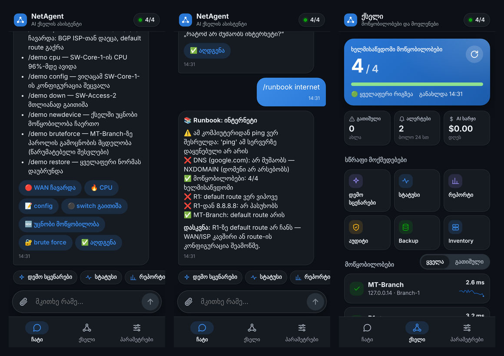

# 🧪 ლაბორატორია: NetAgent-ის გამოცდა რეალური მოწყობილობების გარეშე

| ვარიანტი | რა არის | დრო | რესურსი | რეალური OS? |
|---|---|---|---|---|
| **1. დემო რეჟიმი** (`demo.bat`) | 4 ვირტუალური მოწყობილობა NetAgent-ის შიგნით, ავარიის სცენარებით | 1 წთ | არაფერი | ❌ სიმულაცია |
| **2. MikroTik CHR** (`lab-mikrotik.bat`) | ნამდვილი RouterOS VirtualBox-ში, ავტომატურად | ~10 წთ | 256 MB RAM | ✅ RouterOS |
| **3. Cisco CML-Free** | Cisco-ს ოფიციალური ლაბი, 5 მოწყობილობამდე | 1–2 სთ | 8+ GB RAM | ✅ IOS / IOS XE |
| **3. GNS3** | ღია ლაბი, ბევრი მწარმოებელი | 1–2 სთ | 8+ GB RAM | ✅ რაც დააყენე |

რეკომენდაცია: დაიწყე **1**-ით (ხედავ ყველა ფუნქციას), მერე **2** (ნამდვილი მოწყობილობა 10 წუთში), მერე **3**, თუ Cisco-ს სწავლაც გინდა.

---

## 1. 🎮 დემო რეჟიმი

```
demo.bat                       (Windows)
python -m netagent demo        (ნებისმიერ OS-ზე)
```

გაიხსნება **http://127.0.0.1:8090**, პაროლი: `netagent-demo`. შენი ნამდვილი `.env`-ის AI key გამოიყენება (თუ არის), მაგრამ inventory, backup-ები და პარამეტრები ცალკეა (`data/demo/`) და ნამდვილს არაფერი ეხება. Telegram დემოში გამორთულია.

ქსელი:

```
            ISP (203.0.113.1)
                  │ Gi0/0/0
            ┌─────┴─────┐  Tunnel0 / BGP   ┌───────────┐
            │    R1     ├──────────────────┤ MT-Branch │  MikroTik
            └─────┬─────┘                  └───────────┘
                  │ Gi0/0/1
            ┌─────┴─────┐
            │ SW-Core-1 │  VLAN 10/20, OSPF
            └─────┬─────┘
                  │ Gi1/0/2
            ┌─────┴──────┐
            │ SW-Access-2├── AP-Lobby
            └────────────┘
```



აპში დააჭირე **„დემო სცენარები“** ან დაწერე `/demo`:

| ბრძანება | რა ხდება | რას ნახავ |
|---|---|---|
| `/demo uplink` | R1-ის WAN ჩავარდა, BGP დაეცა, default route გაქრა | Syslog ალერტები მაშინვე, მონიტორინგის ალერტი ~1 წთ-ში. სცადე `/runbook internet` |
| `/demo cpu` | SW-Core-1-ის CPU 96% | 🔥 ალერტი ~1 წთ-ში |
| `/demo config` | ვიღაცამ SW-Core-1-ის config შეცვალა | ვინ და საიდან (syslog), შემდეგ diff ~2 წთ-ში |
| `/demo down` | SW-Access-2 გაითიშა | 🔴 ალერტი, `/runbook device SW-Access-2` |
| `/demo newdevice` | ქსელში უცნობი Raspberry Pi გამოჩნდა | 🆕 ალერტი, `/newdevices` |
| `/demo bruteforce` | MT-Branch-ზე პაროლის გამოცნობა | 🔐 ალერტი მაშინვე, `/logs MT-Branch` |
| `/demo restore` | ყველაფერი ნორმას უბრუნდება | 🟢 აღდგენის ალერტები |

დემოში მონიტორინგი ყოველ წუთში მუშაობს (ნამდვილში 5 წთ), რომ ალერტებს დიდხანს არ ელოდო. სცადე AI-ც: „რატომ არ მუშაობს ინტერნეტი?“, „ვინ შეცვალა SW-Core-1-ის config?“, „რამდენად უსაფრთხოა ქსელი?“.

---

## 2. 📡 MikroTik CHR (ნამდვილი RouterOS, ავტომატურად)

CHR (Cloud Hosted Router) MikroTik-ის უფასო ვირტუალური როუტერია. ლიცენზიის გარეშე სიჩქარე 1 Mbit/s-ით არის შეზღუდული, მაგრამ მართვისა და სწავლისთვის ეს საკმარისია.

```
lab-mikrotik.bat
```

სკრიპტი თვითონ აკეთებს შემდეგს:
1. თუ **VirtualBox** არ გაქვს, აყენებს winget-ით (Windows იკითხავს ნებართვას).
2. MikroTik-ის საიტიდან ჩამოტვირთავს RouterOS-ის უახლეს ვერსიას.
3. ქმნის VM-ს `NetAgent-CHR` (256 MB RAM, ფანჯრის გარეშე).
4. პირველ შესვლაზე აყენებს **ახალ შემთხვევით პაროლს** და პირდაპირ `.env`-ში წერს (`LAB_PASS`). ეკრანზე არ ჩანს და არც ჩატში უნდა ჩასვა.
5. აყენებს syslog-ს ამ კომპიუტერზე და CHR-Lab-ს ამატებს `inventory/devices.yaml`-ში.

შემდეგ გადატვირთე NetAgent (`start.bat`, ან autostart-ის შემთხვევაში `autostart-off.bat` → `autostart-on.bat`) და აპში სცადე `/status`, `/health CHR-Lab`, „CHR-Lab-ის IP-ები მაჩვენე“.

| რა | სად |
|---|---|
| SSH | `127.0.0.1:2230` (user `admin`, პაროლი `.env`-ში `LAB_PASS`) |
| Winbox | `127.0.0.1:8291` |
| გაჩერება | `lab-mikrotik.bat -Stop` |
| თავიდან დაწყება | `lab-mikrotik.bat -Reset` |

> თუ VirtualBox წერს „VT-x is not available“, BIOS-ში ჩართე **Intel VT-x / AMD-V (SVM)**. Hyper-V ჩართულის შემთხვევაში VirtualBox ნელა მუშაობს, მაგრამ მუშაობს.

---

## 3a. 🟦 Cisco CML-Free

Cisco Modeling Labs-ის უფასო ვერსია ერთდროულად 5 მოწყობილობამდე უშვებს. ნამდვილი IOSv/IOL ჩაშენებულია.

**საჭიროა:** 16 GB RAM (მინიმუმ 8), BIOS-ში ჩართული VT-x/AMD-V, Cisco-ს უფასო ანგარიში და VMware Workstation Pro (პირადი გამოყენებისთვის უფასოა).

1. ჩამოტვირთე **CML-Free** (OVA + refplat ISO) Cisco-ს საიტიდან: developer.cisco.com/modeling-labs → Free.
2. VMware-ში: **File → Open → cml2_*.ova**. Settings → Processors → ჩართე **Virtualize Intel VT-x/EPT**. CD/DVD-ში მიუთითე refplat ISO. Network Adapter: **NAT**.
3. ჩართე VM, გაიარე setup wizard. ბოლოს გაჩვენებს მისამართს, მაგ. `https://192.168.x.y`. ის კომპიუტერის ბრაუზერში გახსენი.
4. ახალი ლაბი: დაამატე **External Connector** (რეჟიმი **bridge0**), **unmanaged switch** და 2–3 **IOSv** ან **IOL**. ყველა მოწყობილობის Gi0/0 switch-ზე, switch კი External Connector-ზე მიაერთე. ასე მოწყობილობები VMware-ის NAT ქსელში მოხვდება და Windows-იდან მიუწვდომელი არ იქნება.
5. თითოეულ როუტერზე (კონსოლიდან), პაროლი თვითონ მოიფიქრე:

   ```
   enable
   configure terminal
   hostname R1
   interface GigabitEthernet0/0
    ip address dhcp
    no shutdown
   ip domain name lab.local
   crypto key generate rsa modulus 2048
   ip ssh version 2
   username admin privilege 15 secret <შენი-პაროლი>
   line vty 0 4
    login local
    transport input ssh
   logging host <Windows-ის IP VMware NAT ქსელში, ჩვეულებრივ x.x.x.1>
   end
   write memory
   show ip interface brief
   ```

6. NetAgent-ში: `.env`-ში ჩაწერე `LAB_USER=admin` და `LAB_PASS=<შენი-პაროლი>`. `inventory/devices.yaml`-ში `credentials:`-ში დაამატე:

   ```yaml
     lab:
       username_env: LAB_USER
       password_env: LAB_PASS
   ```

   შემდეგ ჩატში: `/discover 192.168.x.0/24 lab` და დააჭირე **➕ დამატება**.

---

## 3b. 🟩 GNS3

უფასოა და მრავალ მწარმოებელს უჭერს მხარს. MikroTik CHR, VyOS და Arista vEOS ხელმისაწვდომია უფასოდ. Cisco-ს image-ები ცალკე ლიცენზიით მოდის (მაგ. CML-ის გამოწერიდან).

1. ჩამოტვირთე **GNS3 all-in-one** (gns3.com) და **GNS3 VM** (VMware Workstation-ისთვის). ინსტალაციისას Npcap-იც დაყენდება.
2. Windows-ში დაამატე loopback ადაპტერი: `Win+R` → `hdwwiz` → Network adapters → Microsoft → **KM-TEST Loopback Adapter**. მიეცი IP `10.255.0.1/24`.
3. GNS3-ში: **File → New template → Install from GNS3 server** → **MikroTik CHR** (ან VyOS).
4. ლაბში: **Cloud** node (compute: *local*, interface: KM-TEST Loopback), **Ethernet switch** და როუტერები. Cloud → switch → როუტერების ether1/eth0.
5. როუტერებზე IP-ები მიეცი `10.255.0.0/24`-დან (მაგ. MikroTik: `/ip address add address=10.255.0.11/24 interface=ether1`), SSH და მომხმარებელი. syslog-ისთვის: `/system logging action set remote remote=10.255.0.1` და `/system logging add topics=info action=remote`.
6. NetAgent-ში, როგორც CML-ის შემთხვევაში: `lab` credentials, შემდეგ `/discover 10.255.0.0/24 lab` და **➕ დამატება**.

---

## ხშირი პრობლემები

| სიმპტომი | მიზეზი და გამოსავალი |
|---|---|
| `/status`-ში მოწყობილობა 🔴 timeout | Windows-იდან IP მიუწვდომელია. სცადე `ping <IP>` cmd-ში, შეამოწმე bridge/Cloud-ის მიერთება |
| „Authentication failed“ | `.env`-ის `LAB_USER`/`LAB_PASS` და მოწყობილობის `credentials: lab` შეამოწმე |
| Syslog ალერტები არ მოდის | Windows Firewall: Python → Private → Allow. მოწყობილობაზე `logging host` სწორი IP უნდა იყოს |
| VM ძალიან ნელია | ჩართე VT-x BIOS-ში, ან გამორთე Hyper-V (`bcdedit /set hypervisorlaunchtype off`, შემდეგ restart) |
